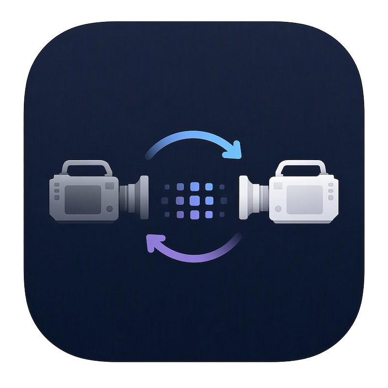

# Sony Config Editor



A desktop tool to read, edit, convert and write the configuration files of the Sony **PXW-FS7** and **PXW-FS7M2** cinema cameras: **Scene Files** (`.SCENE`) and **ALL Files** (`.ALL`, the complete camera settings).

> **Unofficial project.** Not affiliated with, supported by or endorsed by Sony. Sony, PXW-FS7 and PXW-FS7M2 are trademarks of their respective owners. The file formats were researched by comparing real camera files. **Use at your own risk:** back up your camera first (save an All File to the SD card) and test new files on the camera before relying on them. Not every decoded setting is confirmed - see "Status of the decoding".

## What it is for

- Edit a scene look (gamma, matrix, detail, black, white clip, ...) on the computer with the camera's own menu names and value ranges instead of raw numbers.
- **Use scene files from the FS7 on the FS7M2 and back** (e.g. looks bought or downloaded for the Mk1). The conversion keeps camera-specific values on the target model's state and restores the lost values when you switch back.
- Combine and review: compare settings, import single values from other files, build a new file from neutral defaults.

## Features

- Opens `.SCENE` and `.ALL` files (menu, command line or drag and drop); the checksum is verified and rewritten on save, files round-trip byte-identically.
- Settings are grouped like the camera menu (Video, Audio, Misc, Unknown) with dropdowns, step fields (+/- buttons) and check boxes. Unknown IDs stay visible as raw values and are written back unchanged.
- **Options that are impossible in the current state are greyed out** (e.g. RAW 4096 needs Imager Scan Mode Normal, Detail settings with Detail Off, BT.2020 only on the FS7M2 with a 4K format) and implausible combinations raise a warning.
- **Type switch SCENE / ALL** and **model switch FS7 / FS7M2** in the header: only mapped values are carried over, everything else stays stored and returns when you switch back.
- **Search and filter** (Ctrl+F): by name, ID or value; "changed only" shows everything that differs from the loaded file, "known only" hides undecoded IDs.
- **Import** (File > Import, Ctrl+I): take over all known differing values from any SCENE/ALL file of either model, or pick single parameters from a list. One undo step.
- **New** (Ctrl+N): neutral starting point for either model (not a factory reset).
- Undo/redo, changed values are marked, title bar shows unsaved changes.
- Languages switchable at run time (View > Language): English (default), German, Spanish and Italian; High-DPI aware; dark theme.
- Files are loaded defensively: size, line, ID and value limits reject malformed or hostile files.

## Installation

Python 3.10+ with Tkinter (included in the python.org installers; Debian/Ubuntu: `sudo apt install python3-tk`).

```
pip install customtkinter
python SonyConfigEditor.py [file]
```

Settings (language, last folder) are stored in your user config directory (put a `settings.json` next to the program for a portable setup).

## Usage

1. **Open** a scene or ALL file (Ctrl+O) or start a **New** one (Ctrl+N).
2. Change values; use the filter to find them. Greyed-out entries cannot be set in the current state.
3. Choose the **model** (FS7 / FS7M2) and **type** (SCENE / ALL) in the header if you want to convert.
4. Set the **file ID** (name, 16 characters) and **number** (000-999); **Save** (Ctrl+S) writes `NNN.SCENE` / `NNN.ALL` into the folder of the loaded file, **Save As** (Ctrl+Shift+S) lets you choose.
5. Copy the file to the camera's SD card and load it in the camera (Scene File / All File menu, see the camera manual for the folder).

Cine EI note: scene files exist only in Custom mode; in Cine EI mode only ALL files can be written.

## Status of the decoding

IDs are decoded by comparing files and the manuals. Each entry in `scene_parameters.json` / `all_parameters.json` carries a status (`confirmed`, `likely`, `hypothesis`); dropdown entries taken only from the manuals are marked "assumption". Camera test reports and sample files are welcome.

## Build an executable

- Windows: `build_exe.bat` -> `dist\SonyConfigEditor.exe` (needs `pip install pyinstaller`)
- Linux / macOS: `bash build_app.sh` (untested so far)

## Translations

`python -X utf8 -I tools/i18n_keys.py --missing` lists texts without translation. A new language is a new file `translations/<code>.json` (the English texts in the code are the keys; see `translations/de.json`).

## Contact

Questions, camera test reports and sample files: sonyconfigeditor@gmail.com

## License

MIT, see [LICENSE](LICENSE). Copyright (c) 2026 Lukas Himmelswanderer.
